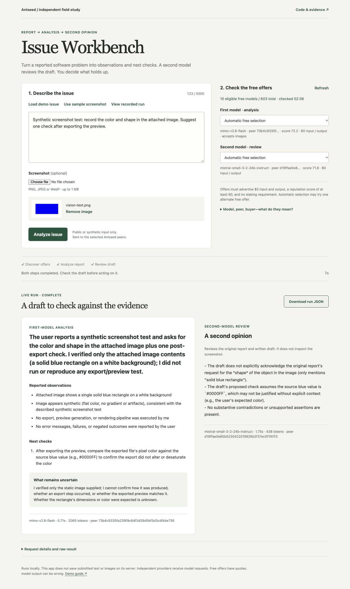

# Antseed Issue Workbench

For a practical meeting-notes workflow, see [Meeting Actions](https://github.com/divyanshAgarwal123/antseed-meeting-actions): review extracted tasks, assign missing owners and dates, then export a CSV, calendar file and follow-up draft. This repository preserves the original Antseed field study and its evidence.

A small app built during an independent, free-feature study of [Antseed](https://antseed.com/) on 2 November 2026. It sends a software issue to one model for structured triage and asks a second model to review the draft. The models can be served by the same or different peers. An optional screenshot can be sent to an image-input text model. The result is a draft for a human to verify.

## Current app

The updated interface shows eligible free offers before a run, streams progress through both steps, and renders the analysis as readable sections. Automatic selection can try one alternate free offer; a failed review keeps the first draft and can be retried on its own. A clearly labelled recorded example works without Antseed running, and a completed run can be downloaded as JSON.



Use the [demo guide](DEMO_GUIDE.md) for a two-minute walkthrough, the spend-cap explanation and questions to prepare for.

## Original 46-second walkthrough

See the issue input, two-model analysis, screenshot flow, provider metadata and published evidence. This video records the initial interface; the screenshot above shows the current version. It is an edited tour of app captures with synthetic input, captions and narration; request waits are omitted.

https://github.com/user-attachments/assets/6d79aa73-44f2-4612-92e9-8cd31c4af090

[Download the MP4](media/workbench-walkthrough.mp4) · [Read the transcript](media/transcript.txt)

## What was tested

- A local Antseed buyer and gateway with an isolated, unfunded test identity
- Live model discovery, peer selection, API-key authentication and a spend cap
- Chat Completions, Responses, Anthropic Messages, JSON mode, tool calls, streaming, image input and peer pinning
- A browser text flow and a browser screenshot flow using two model calls

The latest [eight-case probe](evidence/smoke-results.json) passed all eight checks with HTTP 200 on the tested setup. This was one short session, not an uptime or model-quality benchmark. See the [user diary](USER_JOURNEY.md), [findings](FINDINGS.md) and [evidence guide](EVIDENCE.md) for the details and limits.

## Run it

Install the Antseed CLI using the [official instructions](https://antseed.com/docs/install/). The study used `@antseed/cli@0.1.222` and Python 3.10. In one terminal, start your buyer:

```sh
antseed buyer start
```

In this repository, start the workbench:

```sh
python3 workbench.py
```

Open <http://127.0.0.1:18380>. The app connects to a buyer at `http://127.0.0.1:8377` by default. To use a gateway, supply its URL and your own key through the environment:

```sh
ANTSEED_BASE_URL=http://127.0.0.1:8379 \
ANTSEED_API_KEY='your-key' \
python3 workbench.py
```

To repeat the API probe against a running buyer, use `python3 smoke_features.py`. Both scripts use only the Python standard library. The probe overwrites `evidence/smoke-results.json`; keep a copy of the published run if you want to compare them. Set `ANTSEED_BASE_URL` and `ANTSEED_API_KEY` for a gateway.

## How free peers are selected

The workbench checks the live catalog for text peers advertising zero input and output price, a reputation score of at least 60, and no staking requirement. It prefers previously tested models, then considers other eligible offers. You can select a particular offer or keep automatic selection. It pins each call using `peerId@model` and verifies the peer ID returned in the response. The feature probe also pins its requests. A model name can list free and paid peers, so the model name alone is not a free-price guarantee. If a suitable peer is unavailable, the app stops rather than choosing a paid offer. Catalog prices and availability can change after discovery. Free quotas can still be exhausted.

Offers must support Chat Completions. Explicitly specialised non-conversational categories, such as asset search, are excluded from this workflow. The provider's advertised service ID is also considered when ranking preferences, so a changed catalog alias does not automatically discard a familiar offer.

The analyst can receive a screenshot. The reviewer receives the report and written analysis, not the image. Two different model names are used, but their peers may be the same. A second review has not been shown here to improve accuracy.

To run the offline selection, recovery and HTTP-stream checks, use `python3 -m unittest -v`. These tests use local fixtures and make no model calls.

Use public or synthetic examples. The app does not persist submitted text or images; requests are sent through Antseed to independent providers. The screenshot feature reads an image; it does not generate one. Model output can be incorrect.

## Repository contents

| Path | Purpose |
| --- | --- |
| `workbench.py`, `web/` | Local browser app and two-model workflow |
| `smoke_features.py` | Repeatable eight-case API probe |
| `USER_JOURNEY.md` | First-person setup and use diary |
| `DEMO_GUIDE.md` | Plain-language demo script and questions to prepare for |
| `FINDINGS.md` | Reproduced issue, product observations and suggested next checks |
| `EVIDENCE.md`, `evidence/` | What each published artifact proves |
| `media/` | Short walkthrough, transcript and production notes |

The local CLI install, identity, gateway database and revoked test key are excluded from this repository. No wallet was funded, and no paid-generation, staking or seller operation was tested.
